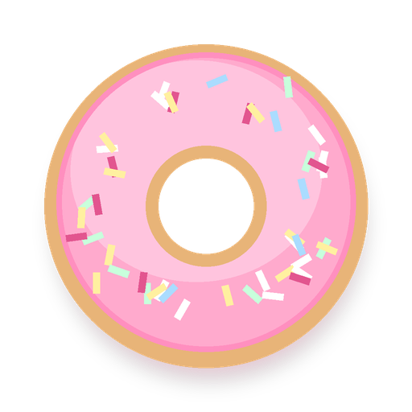

<p align="center"></p>
<h1 align="center">El Donut Engine 🍩</h1>
<p align="center">Mod menu rose pastel pour les parties <b>contre les bots</b> de chess.com, propulsé par Stockfish 17.1 (100 % local).</p>

> ⚠️ **Bots uniquement.** L'extension ne s'active que sur `chess.com/play/computer`. Elle ne fonctionne pas, et ne fonctionnera pas, en partie live contre des humains. L'automatisation peut tout de même enfreindre les CGU de chess.com : utilise-la à tes risques (de préférence sur un compte secondaire).

## ✨ Fonctionnalités
| | |
|---|---|
| **Surligner** | Le meilleur coup s'affiche sur l'échiquier (case de départ + case d'arrivée 🍩) quand c'est ton tour. |
| **Auto** | Le moteur joue le coup tout seul après le délai choisi. Gère la promotion (dame). |
| **Délai** | 0 à 10 s entre chaque coup en mode auto. |
| **Elo du moteur** | 1320 → 3190 (Max = pleine puissance), via `UCI_LimitStrength` de Stockfish. |
| **Profondeur** | 4 à 22 demi-coups. Plus c'est haut, plus c'est fort et plus c'est lent. |
| **Multi-lignes** | Jusqu'à 3 meilleurs coups affichés en même temps, chacun avec son évaluation. |
| **Flèches** | Flèches roses dégradées sur l'échiquier (la plus foncée = le meilleur coup). |
| **Barre d'éval** | Barre d'évaluation à côté du plateau, orientée selon ta couleur, mats inclus. |
| **Délai humain** | Fait varier le délai de ±30 % pour un rythme moins mécanique. |
| **Raccourcis** | `Alt+H` surligner · `Alt+A` auto · `Alt+D` afficher/masquer le menu. |
| **Menu** | Déplaçable (glisse l'en-tête), réductible, réglages sauvegardés. Clic sur l'icône 🍩 = afficher/masquer. |

## 📦 Installation (2 minutes, aucun code requis)
1. Télécharge **`el-donut-engine.zip`** depuis la page [Releases](../../releases) (ou *Code → Download ZIP*) et **dézippe-le**.
2. Ouvre Chrome et va sur `chrome://extensions`.
3. Active le **Mode développeur** (interrupteur en haut à droite).
4. Clique sur **Charger l'extension non empaquetée** et sélectionne le dossier **`extension`**.
5. Épingle l'icône 🍩 dans la barre d'outils (icône puzzle → épingle).
6. Va sur <https://www.chess.com/play/computer>, lance une partie : le menu apparaît en haut à droite.

Marche aussi sur Edge, Brave, Opera et Arc (même procédure via leur page d'extensions).

## 🎮 Utilisation
1. Choisis un bot et lance la partie.
2. Dans le menu, choisis **Surligner** ou **Auto**.
3. Règle l'Elo, la profondeur et le délai. Les changements s'appliquent dès le coup suivant.
4. **Off** met tout en pause sans fermer le menu.

## 🛠️ Architecture
```
extension/
├── manifest.json     # Manifest V3, s'injecte uniquement sur chess.com
├── background.js     # clic sur l'icône → afficher/masquer le menu
├── content.js        # lit le plateau (DOM), construit la FEN, surligne / joue
├── content.css       # style des surlignages + du cadre du menu
├── panel.html/css/js # menu (iframe isolée) + Worker Stockfish
├── engine/           # Stockfish 17.1 lite single-thread (WASM, GPL-3)
└── icons/            # donut 🍩
```
- **Lecture du plateau** : les pièces sont des `.piece.wp.square-52` (colonne 5, rangée 2) dans `wc-chess-board`. Le trait est déduit des cases `.highlight` du dernier coup ; le côté joueur est déduit de la classe `flipped`.
- **Moteur** : il tourne dans un Web Worker à l'intérieur de l'iframe du menu (origine de l'extension), ce qui contourne les restrictions CSP de la page. Aucune requête réseau.
- **Coups auto** : on simule des événements pointeur sur la case de départ puis sur la case d'arrivée.
- **Garde-fou** : `content.js` démonte tout dès que l'URL quitte `/play/computer`.

## ❓ Dépannage
| Problème | Solution |
|---|---|
| Le menu n'apparaît pas | Vérifie que l'URL est bien `/play/computer` et recharge la page. |
| « Chargement du moteur… » reste affiché | Recharge l'extension dans `chrome://extensions`. |
| Le mode auto ne joue pas | chess.com a peut-être changé son DOM : ouvre une *issue*. Le mode Surligner reste utilisable. |
| Mauvais coups au début | Les droits de roque et la prise en passant sont estimés depuis le plateau ; c'est rare mais possible. |

## 📜 Licence
GPL-3.0 (Stockfish est GPL-3). Projet non affilié à chess.com.
